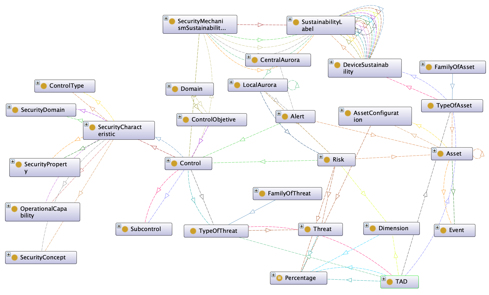

# AURORA Ontology

## Introduction

AURORA is an ontology designed for collaborative cybersecurity and sustainability risk management in IoT-based smart environments. It integrates three complementary knowledge layers:

- **ROMA**, which provides the core risk management model derived from the MARISMA metapattern.
- **EcoSec**, which incorporates sustainability assessment for devices and security mechanisms.
- **AURORA Collaborative Layer**, which introduces distributed intelligence, event management, alert propagation, trust relationships, and federated risk monitoring across interconnected smart environments.

Together, these components provide a semantic framework capable of representing not only risks, threats, assets, controls, and sustainability aspects, but also the operational processes required to detect, propagate, mitigate, and reassess cybersecurity risks in dynamic IoT ecosystems.

## Purpose

The primary purpose of AURORA is to provide a unified semantic framework for:

- Cybersecurity risk management.
- Sustainability-aware security analysis.
- Distributed IoT monitoring.
- Alert generation and propagation.
- Collaborative threat intelligence sharing.
- Risk reassessment and control validation.

AURORA enables smart homes, IoT deployments, and cyber-physical environments to exchange cybersecurity knowledge while maintaining local autonomy and trust-based collaboration.

## Architecture Overview

AURORA is organized into three integrated layers:

```text
AURORA
│
├── ROMA Layer
│     ├── Assets
│     ├── Threats
│     ├── Risks
│     ├── Controls
│     ├── TAD Relations
│     └── Security Characteristics
│
├── EcoSec Layer
│     ├── Sustainability Labels
│     ├── Sustainability Security
│     ├── Sustainability Ratings
│     ├── Sustainability Aspects
│     └── Product Lifecycle Phases
│
└── Collaborative AURORA Layer
      ├── CentralAurora
      ├── LocalAurora
      ├── Events
      ├── Alerts
      ├── Trust Relationships
      ├── Alert Propagation
      └── Risk Reassessment
```

## Conceptual UML model

Conceptual UML model of the AURORA ontology framework. The green, white, and pink areas identify the EcoSec sustainability module, the ROMA cybersecurity risk-management module, and the AURORA collaborative-awareness module, respectively. The relationships among the modules illustrate their semantic integration within the framework.


## AURORA ontology

The following figure provides an overview of the implemented ontology framework obtained using the Protégé OntoGraf visualisation tool. It illustrates the principal classes and relationships composing the EcoSec, ROMA, and AURORA modules.




## Competency Questions

The ontology was validated through a set of competency questions (CQs) covering the sustainability, cybersecurity risk-management, collaborative-awareness, and cross-module integration capabilities of the framework.

The repository contains a dedicated directory: CompetencyQuestions/

which includes executable SPARQL implementations for all competency questions:

CQ-E1.rq ... CQ-E4.rq   (EcoSec)

CQ-R1.rq ... CQ-R5.rq   (ROMA)

CQ-A1.rq ... CQ-A6.rq   (AURORA)

CQ-X1.rq ... CQ-X4.rq   (Cross-module)

The competency questions are grouped as follows:

EcoSec Competency Questions

- CQ-E1: What sustainability assessment is associated with each lifecycle dimension of a given technological device?
- CQ-E2: Which lifecycle dimensions of a technological device present the least favourable sustainability assessments?
- CQ-E3: What sustainability assessments are associated with the adoption, maintenance, and operational efficiency of a given cybersecurity mechanism?
- CQ-E4: How do two sustainability labels compare in terms of their sustainability level?

ROMA Competency Questions

- CQ-R1: Which risks are associated with a given asset?
- CQ-R2: Which asset, threat, and security dimension are associated with a given risk?
- CQ-R3: What is the current risk level associated with a given risk?
- CQ-R4: Which controls are associated with a given risk and which threats can they mitigate?
- CQ-R5: Which security characteristics are associated with a given control?

AURORA Competency Questions

- CQ-A1: Which asset is affected by a given cybersecurity alert?
- CQ-A2: What is the current lifecycle status of a given alert?
- CQ-A3: Which LocalAurora entities are associated with a given CentralAurora entity?
- CQ-A4: Which alerts are currently known by a given CentralAurora or LocalAurora entity?
- CQ-A5: Which risks are associated with a given LocalAurora entity?
- CQ-A6: Which LocalAurora entities are connected through collaborative relationships and can therefore participate in alert sharing?

Cross-Module Competency Questions

- CQ-X1: Which collaborative entities are potentially affected by a given cybersecurity alert according to the assets and risks they manage?
- CQ-X2: What sustainability information is associated with the technological asset affected by a given cybersecurity alert?
- CQ-X3: Which cybersecurity controls are applicable to a risk affecting an alerted asset, and what sustainability information is associated with those controls?
- CQ-X4: Which risks associated with a collaborative entity may be affected by an alert concerning the same asset?

The SPARQL queries included in this directory provide direct traceability between the competency questions defined in the paper and their executable implementations.